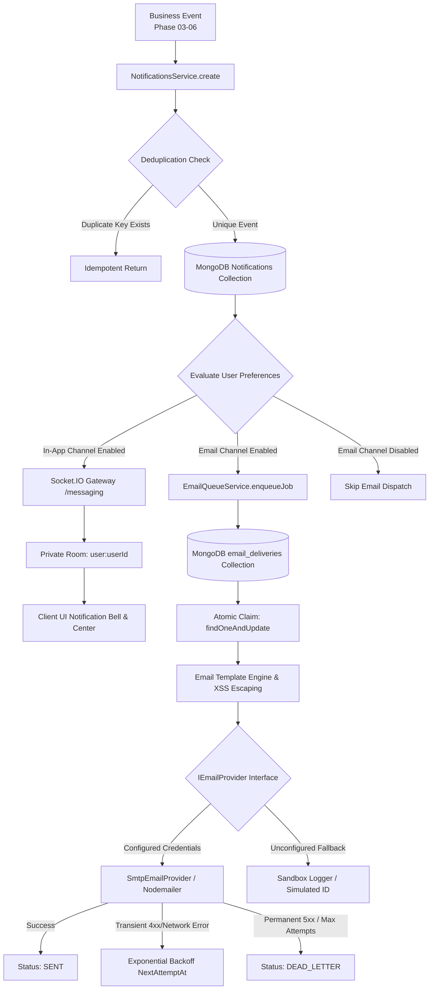

# Brands & Creators — Phase 07 Implementation Specification
## Notification Center, Email Delivery, Real-Time Alerts & Notification Preferences

---

## 1. System Architecture Overview

Phase 07 unifies the event-driven notifications across the Brands & Creators marketplace into a single, high-reliability pipeline that supports:
- **Real MongoDB Persistence**: Every notification is safely persisted before delivery attempts.
- **Recipient Isolation & Ownership**: Recipient identity is derived from verified business records; users can never read, modify, or spoof other users' notifications.
- **User Notification Preferences**: Granular control over in-app alerts and email dispatches by category, with an un-bypassable safeguard for critical security notices.
- **Real-Time WebSockets**: Dispatched via authenticated Socket.IO rooms (`user:${userId}`) on the `/messaging` namespace.
- **Durable Email Delivery Queue**: MongoDB-backed atomic job claiming (`findOneAndUpdate`), preventing race conditions, with exponential retry backoff and sandbox fallback.
- **Administrative Monitoring**: Complete visibility into queue health, delivery logs, sanitized errors, manual job retries, and broadcast platform announcements.



---

## 2. Supported Notification Event Catalog

| Event Type Identifier | Category | Default Channels | Description |
|---|---|---|---|
| `APPLICATION_RECEIVED` | `applications` | In-App, Email | Dispatched to Brand when a creator applies to a brief. |
| `APPLICATION_SHORTLISTED` | `applications` | In-App, Email | Dispatched to Creator when shortlisted by a brand. |
| `APPLICATION_ACCEPTED` | `applications` | In-App, Email | Dispatched to Creator when application is formally accepted. |
| `APPLICATION_REJECTED` | `applications` | In-App, Email | Dispatched to Creator when application is declined. |
| `APPLICATION_WITHDRAWN` | `applications` | In-App | Dispatched to Brand when an applicant withdraws a proposal. |
| `REQUIREMENT_MATCH` | `applications` | In-App | Dispatched to Creator when matching requirements are published. |
| `PROJECT_CREATED` | `projects` | In-App, Email | Dispatched to Creator & Brand when project workspace initializes. |
| `PROJECT_STARTED` | `projects` | In-App, Email | Dispatched when contract terms begin. |
| `PROJECT_COMPLETED` | `projects` | In-App, Email | Dispatched upon final signoff and delivery approval. |
| `PROJECT_CANCELLED` | `projects` | In-App, Email | Dispatched if workspace is terminated early. |
| `MILESTONE_ASSIGNED` | `projects` | In-App | Dispatched when new milestone is scoped. |
| `MILESTONE_SUBMITTED` | `projects` | In-App, Email | Dispatched to Brand when milestone is ready for review. |
| `DELIVERABLE_SUBMITTED`| `projects` | In-App, Email | Dispatched to Brand upon asset version upload. |
| `REVISION_REQUESTED` | `projects` | In-App, Email | Dispatched to Creator with structured revision notes. |
| `DELIVERABLE_APPROVED` | `projects` | In-App, Email | Dispatched to Creator upon asset acceptance. |
| `TASK_ASSIGNED` / `TASK_UPDATED` | `projects` | In-App | Dispatched for workspace task management. |
| `NEW_MESSAGE` | `messages` | In-App, Email | Dispatched to conversation recipients (self-messages omitted). |
| `PAYMENT_ORDER_CREATED`| `payments` | In-App | Dispatched when escrow payment order is generated. |
| `PAYMENT_SUCCESS` | `payments` | In-App, Email | Dispatched upon authoritative gateway signature verification. |
| `PAYMENT_FAILED` | `payments` | In-App, Email | Dispatched upon payment capture failure. |
| `REFUND_REQUESTED` | `payments` | In-App, Email | Dispatched when a partial or full refund is initiated. |
| `REFUND_COMPLETED` | `payments` | In-App, Email | Dispatched when refund is recorded in ledger. |
| `PAYOUT_PENDING` | `payments` | In-App | Dispatched to Creator when payout is generated in escrow. |
| `PAYOUT_COMPLETED` | `payments` | In-App, Email | Dispatched when payout settlement is confirmed. |
| `NEW_REVIEW` / `REVIEW_RECEIVED` | `reviews` | In-App, Email | Dispatched upon completion review submission. |
| `REVIEW_REPORTED` | `reviews` | In-App | Dispatched to staff upon dispute filing. |
| `SYSTEM_ALERT` | `security` | In-App, Email | Account alerts, password updates, security warnings (Essential). |
| `SYSTEM_ANNOUNCEMENT` | `marketing` | In-App, Email | Admin-broadcast platform notices with role filters. |

---

## 3. Data Models & MongoDB Schemas

### 3.1 `NotificationSchema` (`notifications` Collection)
Extended from the existing schema to guarantee backward compatibility with earlier phase test assertions while adding structured metadata:

```typescript
@Schema({ timestamps: true, collection: 'notifications' })
export class Notification {
  @Prop({ type: Types.ObjectId, ref: 'User', required: true, index: true })
  userId: Types.ObjectId;

  @Prop({ required: true, enum: NotificationType, index: true })
  type: NotificationType;

  @Prop({ required: true, trim: true })
  title: string;

  @Prop({ required: true, trim: true })
  message: string;

  @Prop({ trim: true })
  body?: string;

  @Prop({ trim: true })
  link?: string;

  @Prop({ trim: true })
  actionUrl?: string;

  @Prop({ type: [String], enum: NotificationChannel, default: [NotificationChannel.IN_APP] })
  channels: NotificationChannel[];

  @Prop({ default: false, index: true })
  isRead: boolean;

  @Prop({ type: Date })
  readAt?: Date;

  @Prop({ trim: true })
  entityType?: string;

  @Prop({ type: Types.ObjectId })
  entityId?: Types.ObjectId;

  @Prop({ type: Object })
  metadata?: Record<string, any>;

  @Prop({ type: String, sparse: true, index: true })
  deduplicationKey?: string;
}
```

**Indexes:**
- `{ userId: 1, createdAt: -1 }`: Optimizes user feed retrieval.
- `{ userId: 1, isRead: 1 }`: Optimizes unread counter queries.
- `{ deduplicationKey: 1 }` (Sparse): Prevents duplicate event insertion.

---

### 3.2 `NotificationPreferenceSchema` (`notification_preferences` Collection)
Stores persistent channel delivery consent per user:

```typescript
@Schema({ timestamps: true, collection: 'notification_preferences' })
export class NotificationPreference {
  @Prop({ type: Types.ObjectId, ref: 'User', required: true, unique: true, index: true })
  userId: Types.ObjectId;

  @Prop({ type: ChannelCategoryPreferencesSchema, default: () => ({}) })
  inApp: ChannelCategoryPreferences;

  @Prop({ type: ChannelCategoryPreferencesSchema, default: () => ({}) })
  email: ChannelCategoryPreferences;

  @Prop({ type: String, enum: ['INSTANT', 'DAILY', 'WEEKLY', 'NONE'], default: 'INSTANT' })
  digestFrequency: string;

  @Prop({ type: Boolean, default: false })
  quietHoursEnabled: boolean;

  @Prop({ type: String, default: '22:00' })
  quietHoursStart: string;

  @Prop({ type: String, default: '08:00' })
  quietHoursEnd: string;

  @Prop({ type: String, default: 'Asia/Kolkata' })
  timezone: string;
}
```

---

### 3.3 `EmailDeliveryJobSchema` (`email_deliveries` Collection)
Provides a durable, race-free queue for transactional email dispatch:

```typescript
@Schema({ timestamps: true, collection: 'email_deliveries' })
export class EmailDeliveryJob {
  @Prop({ type: Types.ObjectId, ref: 'Notification', index: true })
  notificationId?: Types.ObjectId;

  @Prop({ type: Types.ObjectId, ref: 'User', required: true, index: true })
  recipientId: Types.ObjectId;

  @Prop({ required: true, lowercase: true, trim: true, index: true })
  recipientEmail: string;

  @Prop({ trim: true })
  recipientName?: string;

  @Prop({ required: true, index: true })
  template: string;

  @Prop({ required: true })
  subject: string;

  @Prop({ required: true })
  html: string;

  @Prop({ required: true })
  text: string;

  @Prop({ required: true, enum: EmailDeliveryStatus, default: EmailDeliveryStatus.PENDING, index: true })
  status: EmailDeliveryStatus;

  @Prop({ default: 0 })
  attempts: number;

  @Prop({ default: 3 })
  maxAttempts: number;

  @Prop({ type: Date, default: Date.now, index: true })
  nextAttemptAt: Date;

  @Prop({ trim: true })
  error?: string;

  @Prop({ trim: true })
  providerMessageId?: string;

  @Prop({ type: Date })
  completedAt?: Date;

  @Prop({ type: Object })
  metadata?: Record<string, any>;
}
```

---

## 4. API Endpoints Catalog

All endpoints are prefixed with `/api/v1` and protected by `JwtAuthGuard` or `RolesGuard`.

### User Endpoints

| Method | Endpoint | Description |
|---|---|---|
| `GET` | `/notifications` | Get paginated notifications feed (supports `page`, `limit`, `type`, `isRead`, `search`). Returns `{ notifications, items, total, unreadCount, page, limit, totalPages }`. |
| `GET` | `/notifications/unread-count` | Returns `{ unreadCount: number }` for authenticated user. |
| `PATCH` | `/notifications/:id/read` | Marks a single notification read. Strictly checks `userId === req.user.userId`. |
| `PATCH` | `/notifications/read-all` | Marks all unread notifications read for the current user. |
| `GET` | `/notifications/preferences` | Fetches or lazily initializes preferences for current user. |
| `PATCH` | `/notifications/preferences` | Updates category toggles (`inApp`, `email`), quiet hours, or cadence. |
| `GET` / `PATCH` | `/notification-preferences` | Route alias for preferences. |

### Administrative Endpoints (`@Roles(UserRole.ADMIN, UserRole.SUPER_ADMIN)`)

| Method | Endpoint | Guard | Description |
|---|---|---|---|
| `GET` | `/admin/notifications/metrics` | `AdminJwt` | Returns queue health counts (`total`, `pending`, `processing`, `sent`, `failed`, `deadLetter`, `providerConfigured`). |
| `GET` | `/admin/notifications/deliveries` | `AdminJwt` | Lists delivery jobs with filters for `status`, `search`, `page`, and `limit`. |
| `GET` | `/admin/notifications/deliveries/:id` | `AdminJwt` | Returns single delivery job record with recipient metadata. |
| `POST` | `/admin/notifications/deliveries/:id/retry` | `AdminJwt` | Re-queues a failed or dead-letter job with atomic status reset. |
| `POST` | `/admin/notifications/test-email` | `AdminJwt` | Dispatches an operational verification email to a verified address. |
| `POST` | `/admin/notifications/announcement` | `AdminJwt` | Broadcasts platform announcement notification to all or targeted user roles. |
| `POST` | `/admin/notifications/queue/process` | `AdminOrCronGuard` | Triggers immediate batch queue processing and crash recovery sweep. Accepts either `x-cron-secret` header or Admin Bearer JWT. |

---

## 5. Real-Time Socket.IO Architecture

- **Namespace**: `/messaging` (Reuses the established Phase 04 Socket.IO server; no competing socket server).
- **Authentication**: JWT token supplied via `auth.token` or `Authorization` header during handshake.
- **Room Isolation**: Automatically joins `user:${userId}` on connection. The gateway refuses client-supplied room joining for foreign user rooms.
- **Emitted Events**:
  - `notification:new`: Emitted when a new notification is generated. Payload includes notification document.
  - `notification:read`: Emitted when an item is marked read. Payload: `{ notificationId, unreadCount }`.
  - `notification:read-all`: Emitted when user marks all read.
  - `notification:unread-count`: Emitted with integer counter on read state mutations.

---

### 6.1 Provider Abstraction & Semantic Error Classification
Defined under `apps/api/src/modules/notifications/email/email-provider.interface.ts` and implemented by `SmtpEmailProvider` (`smtp.provider.ts`) using `nodemailer`.

#### RFC 5321 Semantic Error Classification Matrix
Errors returned by SMTP providers and network layers are strictly classified based on their underlying semantics rather than crude 4xx/5xx heuristics:

| Error Category | Indicators / Status Codes | Retryable? | Next Attempt Action |
|---|---|---|---|
| **Network Timeout & Connection Drops** | `ETIMEDOUT`, `ECONNRESET`, `ECONNREFUSED`, `ESOCKET`, `ENOTFOUND`, `EAI_AGAIN`, `EPIPE` | **YES** | Bounded exponential backoff with jitter (`30s * 2^(attempts-1) + 0..15s`). |
| **Transient Mailbox / Server Conditions** | SMTP `421` (Service unavailable), `450` (Mailbox busy), `451` (Local error in processing), `452` (Insufficient storage), `454` (TLS temporarily unavailable) | **YES** | Bounded exponential backoff with jitter. |
| **Rate Limiting / Throttling** | HTTP/SMTP `429`, "rate limit", "too many requests", "throttled" | **YES** | Delay retry, honoring provider backoff windows. |
| **Provider-Specific Gateway Errors** | `503` (Service Unavailable), `504` (Gateway Timeout), `521` (Web server down), `554` containing "try again" | **YES** | Exponential retry backoff. |
| **Permanent Recipient Failure** | SMTP `550` (User unknown / mailbox not found), `551` (User not local), `553` (Mailbox name not allowed) | **NO** | Immediately mark `DEAD_LETTER`. Prevent sender reputation damage. |
| **Authentication & Configuration Failures** | SMTP `535`, `534` (Authentication failed), `EAUTH`, invalid TLS config | **NO** | Immediately mark `DEAD_LETTER`. Redact credentials in logs. |
| **Message Specification & Policy Failures** | SMTP `501`, `502` (Syntax error), `552` (Exceeded message size limit), `554` (Transaction rejected) | **NO** | Immediately mark `DEAD_LETTER`. |

#### Credential & PII Redaction
All provider error strings pass through `redactSensitiveData(errorMsg)` before persistence to `email_deliveries`:
- Passwords (`password=...`) are replaced with `password=[REDACTED]`.
- Auth tokens and Bearer strings are stripped and replaced with `[REDACTED]`.
- Recipient email addresses in stack traces are masked as `us***@domain.com`.

#### Fallback Sandbox Mode & Database Visibility
When SMTP environment variables (`SMTP_HOST`, `SMTP_USER`, `SMTP_PASS`) are unprovisioned, `SmtpEmailProvider` automatically operates in fallback sandbox mode:
- Deliveries are logged to the console with masked recipients.
- Returns `{ success: true, messageId: 'sim_...', simulated: true, isRetryable: false }`.
- Delivery records explicitly record `isSimulated: true` and `metadata.simulated = true` in MongoDB, preventing any false reporting of live delivery.
- Admin UI at `/notifications/deliveries` displays a distinct amber `Sandbox Mode` badge next to `SENT` for simulated deliveries.

### 6.2 Template Engine & XSS Prevention
- Reusable HTML card layout adhering to modern aesthetics (clean surface, subtle indigo accents, rounded container, accessible typography).
- `escapeHtml` utility escapes all dynamic user-controlled strings (`&`, `<`, `>`, `"`, `'`) before template interpolation.
- Plain-text alternative rendered for screen readers and text-only mail clients.
- Subject lines and bodies strictly redact passwords, tokens, full private chats, and bank details.

---

## 7. Preferences, Quiet Hours & Event Integrations

### 7.1 Notification Category Gating & Quiet Hours
- **Category Preferences**: Checked before optional channels are scheduled. Disabling email for a category never disables in-app notification persistence.
- **Essential Notices**: Security notices (`SYSTEM_ALERT`) strictly bypass preference checks.
- **Timezone-Aware Quiet Hours**: Evaluated using recipient's configured timezone (e.g., `Asia/Kolkata`). When inside quiet hours:
  - Real-time socket emission includes `isQuietHours: true`, allowing client audio muting.
  - Non-urgent email deliveries defer initial attempt to the end of the quiet period.
- **Honest Digest Cadence UX**: `INSTANT` and `NONE` are active; `DAILY` and `WEEKLY` are disabled with "(Coming Soon in v2.0)" in frontend and DTO schemas to prevent misleading users.

### 7.2 Real Event Integrations Verified
- **Marketplace**: `APPLICATION_RECEIVED`, `APPLICATION_SHORTLISTED`, `APPLICATION_ACCEPTED`, `APPLICATION_REJECTED`, `APPLICATION_WITHDRAWN`, `REQUIREMENT_MATCH`.
- **Messaging**: `NEW_MESSAGE` (counterparty notification with self-message deduplication).
- **Projects**: `PROJECT_CREATED`, `PROJECT_STARTED`, `PROJECT_COMPLETED`, `MILESTONE_ASSIGNED`, `MILESTONE_SUBMITTED`, `DELIVERABLE_SUBMITTED`, `REVISION_REQUESTED`, `DELIVERABLE_APPROVED`.
- **Commerce**: `PAYMENT_SUCCESS`, `PAYMENT_FAILED`, `REFUND_REQUESTED`, `REFUND_COMPLETED`, `PAYOUT_PENDING`, `PAYOUT_COMPLETED`.
- **Reputation**: `NEW_REVIEW`, `REVIEW_RECEIVED`.
- **Security & Admin**: `SYSTEM_ALERT`, `SYSTEM_ANNOUNCEMENT`.

### 7.3 Admin Announcements & Audit Trail
- Admin broadcast endpoint (`POST /admin/notifications/announcement`) accepts target user roles, batches inserts into chunks of 25, and uses MD5 deduplication keys (`announcement_${hash}_${userId}`).
- Administrative operations (`QUEUE_PROCESSED`, `NOTIFICATION_RETRY`, `ANNOUNCEMENT_BROADCAST`) automatically generate immutable audit entries in the `auditLogs` collection via `AuditLogsService`.

---

## 8. Deployment & Background Worker Strategy

### Vercel (Frontend: `apps/web` & `apps/admin`)
- Fully compatible with Vercel edge/serverless deployment.
- All dynamic search params wrapped in React `<Suspense>` boundaries.

### Hostinger Node Web App (Backend: `apps/api`)
- **Worker Execution Architecture**:
  1. `EmailQueueService` implements `OnModuleInit` and starts an active interval runner (`setInterval` every 30 seconds, `unref()`'d).
  2. Every notification creation dispatches an unblocked `setImmediate(() => emailQueue.processNextBatch())`.
  3. **Atomic Job Claiming**: `findOneAndUpdate({ status: PENDING, nextAttemptAt: { $lte: new Date() } }, { $set: { status: PROCESSING, updatedAt: new Date() } })` guarantees mutual exclusion across concurrent worker instances.
  4. **Crash Recovery**: Stale jobs in `PROCESSING` status older than 5 minutes (`updatedAt < now - 5m`) are automatically reclaimed and re-executed.
  5. **Hostinger Cron Trigger & Security (`AdminOrCronGuard`)**:
     - Dedicated `CRON_SECRET` environment variable prevents reliance on expiring admin JWTs.
     - Compares incoming `x-cron-secret` header using timing-safe buffer comparison (`crypto.timingSafeEqual`).
     - Rejects unauthorized requests with `401 Unauthorized` or `403 Forbidden`.
     - Logs automated sweeps to `auditLogs` under actor `Hostinger Cron Scheduler`.
     - Returns explicit batch counts: `{ success: true, authType: 'CRON_SECRET', processed: N, success: N, failed: N, timestamp: ... }`.
     - **Hostinger cPanel Crontab Command**:
       ```bash
       * * * * * curl -s -X POST https://api.brandsandcreators.com/api/v1/admin/notifications/queue/process -H "x-cron-secret: $CRON_SECRET" > /dev/null 2>&1
       ```

